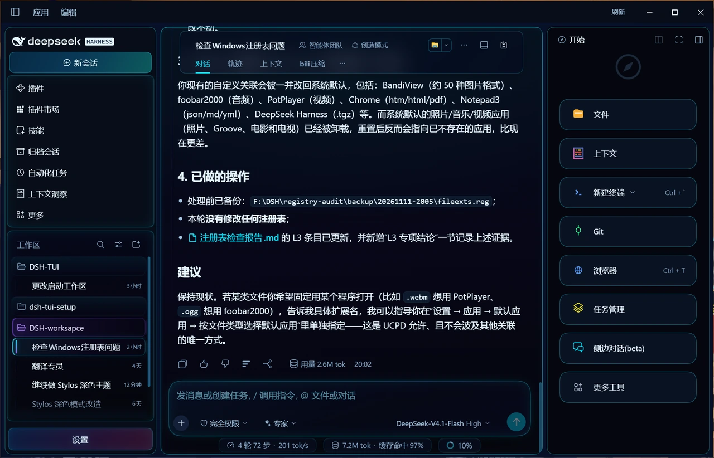
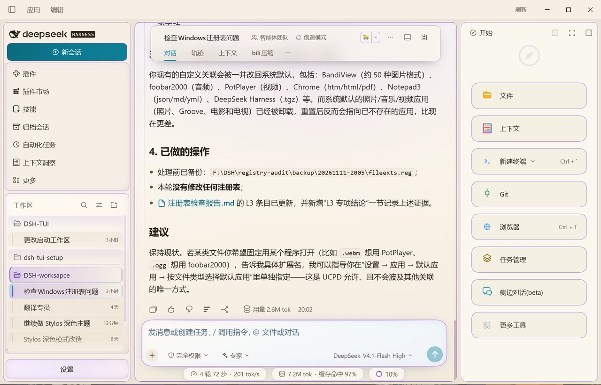
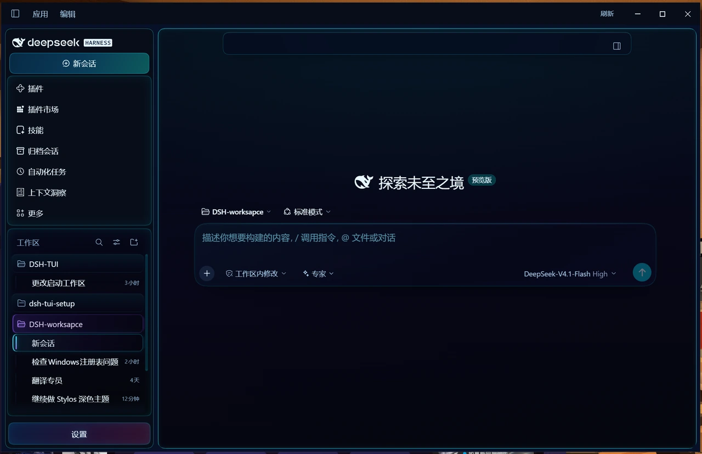
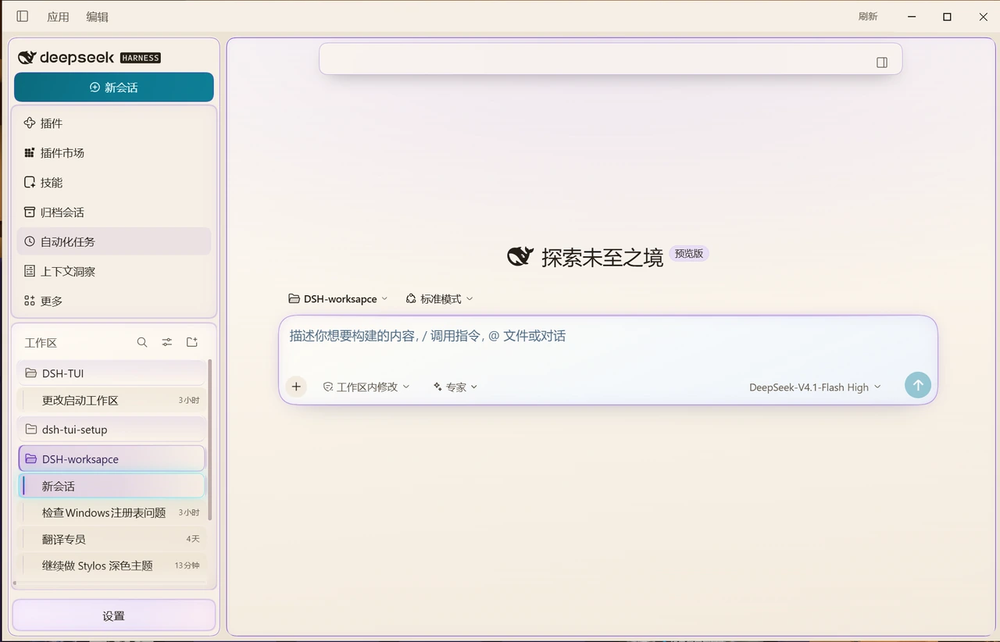

# dsh-client-ui-cyberpunk

[](./LICENSE)
[](https://github.com/kemone/dsh-client-ui-cyberpunk/releases)
[](https://github.com/deepseek-ai)

**A cyberpunk neon skin for the DeepSeek Harness web GUI.** Dark navy surfaces, cyan hairlines, a deep-red text
selection, plus a warm-paper light theme with violet borders. Everything is CSS: the skin overrides the host's
design tokens (`--dsw-*`), adds a few structural rules and two settings slots. It ships no runtime dependency,
imports no React module of its own, and keeps the host half an empty `apply()`.

> 中文说明在下半部分（[跳到中文](#赛博朋克皮肤-中文说明)）。

## What it looks like

| Layer | Dark theme | Light theme |
|---|---|---|
| Base / rail | `#05070f` / `#070d19` | `#faf6ef` / `#efe7d9` |
| Overlay, bubble, composer | `#0a1222` → `#142540` | `#fffdf8` → `#f4ece0` |
| Hairline | cyan `#00e5ff` at 12–42 % | violet `#6d3bd1` at 16–55 % |
| Accent / focus ring | neon cyan | violet |
| Text selection | `#8c0f28` at 50 % | `#8c0f28` at 50 % |
| Code syntax | cyan / magenta / lilac / olive | teal / violet / amber on paper |

Both themes keep the same geometry: the three column frame, the sidebar glass blocks and the composer card sit in
exactly the same place, so switching `light` / `dark` / `system` only swaps colours.

## Screenshots

| | Dark | Light |
|---|---|---|
| Conversation |  |  |
| New session |  |  |

Taken on Windows 11 against DSH desktop `0.2.1-rc.5`.

## Install

Requires DSH `0.2.x` (desktop or web profile).

```powershell
# from npm, once published
dsh plugin --profile desktop add dsh-client-ui-cyberpunk

# from the GitHub release asset (no build step)
#   1. download dsh-client-ui-cyberpunk-0.1.282.tgz
#      https://github.com/kemone/dsh-client-ui-cyberpunk/releases/latest
#   2. install the downloaded file
dsh plugin --profile desktop add F:\path\to\dsh-client-ui-cyberpunk-0.1.282.tgz

# or from a checkout: build the same tarball yourself, then install it
npm pack
dsh plugin --profile desktop add .\dsh-client-ui-cyberpunk-0.1.282.tgz

# or link a checkout while editing the skin
dsh plugin --profile desktop add link:F:\path\to\dsh-client-ui-cyberpunk
```

Every release carries the packaged tarball as an asset, so the repository itself stays source-only;
the tarball is not committed to git.

Installing registers the package in the profile's `dsh.profile.bundles`, so it also shows up in
**Settings → Plugins**.

## Enable / disable

- GUI: **Settings → Plugins → `dsh-client-ui-cyberpunk`** toggle;
- CLI: add an override to the profile's `cordis.patch.yml`:

```yaml
- id: ui-cyberpunk
  disabled: true
```

Uninstall:

```powershell
dsh plugin --profile desktop remove dsh-client-ui-cyberpunk
```

## Settings (two entry points)

- **Settings → General → “Cyberpunk skin” row** — five feature switches (frame breathing light, selected-row
  sweep, session status marks, settings-page HUD, code-block chrome). One row, applied instantly.
- **Settings → Cyberpunk skin** — the full control page: main accent colour (drives 55 rules), colour and
  intensity for the three border groups (columns / sidebar glass blocks / composer card), breathing speed,
  per-group reset, and a confirmed “reset everything”. The accent's bright variant is derived with
  `color-mix(accent 78%, base)`, so it stays readable on both themes.

## Compatibility

- Pure CSS custom properties, no React version constraint.
- Host half (`lib/index.js`) is an empty `apply()`; nothing runs in Node.
- Client half registers one factory: a `<style>` element, two settings slots (`settings.section` control page and
  `settings.general.item` summary row) and a few read-only DOM injectors; all of it is removed on dispose.
- Layout rules target the host's CSS-Modules class names (`.mP3x-q_frame`, `.wnFoaW_sessionRow`, `.acoR2W_panel`,
  `.wtg9ga_*`). A DSH upgrade that renames them makes those rules silently stop matching — check visually after
  major host upgrades.
- Verified against DSH desktop `0.2.1-rc.5`. The control page lives in the `settings.section` slot
  (`id: cyberpunk-theme`, `order: 5`); status marks read the host's `data-state` attribute only, so they work in
  every UI language.
- No `peerDependencies` on `@deepseek-ai/cordis`: the desktop profile does not install it separately, so a peer
  range would only produce warnings. The real compatibility surface is the class names and slot contracts above.

### Known limits

- `!important` is limited to the switch layer (`body[data-dsh-off~='<id>']`) and a few structural rules needed to
  win against the host's inline styles.
- The session-row status outline uses `outline`, so it does not shift layout; Windows high-contrast mode overrides it.
- Animations respect `prefers-reduced-motion: reduce`.

## Development

```powershell
npm test      # node --check + manifest/package-shape checks
npm pack      # builds the installable tarball
```

See [docs/DEVELOPING.md](./docs/DEVELOPING.md) for the style-file layout, the token layers and the host-contract
notes (including the `inject` gotcha that silently removes the settings page).

## License

MIT. The visuals borrow from the broad “cyberpunk / neon HUD” design vocabulary. This project is **not affiliated
with CD PROJEKT RED**; no assets, trademarks, fonts or layouts from *Cyberpunk 2077* are used.

---

# 赛博朋克皮肤（中文说明）

DeepSeek Harness Web GUI 的赛博朋克配色皮肤。以覆盖官方设计 token（`--dsw-*`）为主，另加少量布局属性与边框规则
（三栏圆角边框、侧栏分区框、输入框毛玻璃），不注入 React、不依赖宿主服务，因此不会影响会话本身。

## 效果

| 层 | 深色 | 浅色 |
|---|---|---|
| 底色 / 侧栏 | `#05070f` / `#070d19` 近黑冷蓝 | `#faf6ef` / `#efe7d9` 暖白象牙 |
| 浮层、气泡、输入框 | `#0a1222` → `#142540` 蓝紫阶梯 | `#fffdf8` → `#f4ece0` |
| 描边 | 青色发丝线 `#00e5ff` 12%–42% | 紫罗兰 `#6d3bd1` 16%–55% |
| 强调 / 链接 / 焦点环 | 霓虹青 | 紫罗兰 |
| 文字选中 / 文档选区 | 暗红 `#8c0f28` 50% | 暗红 `#8c0f28` 50% |
| 代码语法 | 青 / 品红 / 紫 / 橄榄，注释冷灰蓝 | 纸面青 / 紫 / 琥珀 |

两套主题共用同一份结构规则，只替换 token，所以三栏边框、侧栏玻璃块、输入卡在两种模式下位置完全一致。
切换在 **设置 → 通用 → 外观**（或 `preference: light | dark | system`）。

截图见 [docs/screenshots](docs/screenshots)：深色 / 浅色 各两张（会话页、新建会话页）。

## 安装

需求：DSH `0.2.x`（desktop 或 web profile 均可）。

```powershell
# 已发布到 npm 后
dsh plugin --profile desktop add dsh-client-ui-cyberpunk

# 从 GitHub Release 附件安装（无需自己打包）
#   1. 下载 dsh-client-ui-cyberpunk-0.1.282.tgz
#      https://github.com/kemone/dsh-client-ui-cyberpunk/releases/latest
#   2. 安装下载到的文件
dsh plugin --profile desktop add F:\path\to\dsh-client-ui-cyberpunk-0.1.282.tgz

# 或在仓库里自己打同一个包再装
npm pack
dsh plugin --profile desktop add .\dsh-client-ui-cyberpunk-0.1.282.tgz

# 或直接链接本地目录（改样式时免打包）
dsh plugin --profile desktop add link:F:\path\to\dsh-client-ui-cyberpunk
```

每个 Release 都附带打包好的 tgz，仓库只放源码，不再把 tgz 提交进 git。

安装会把它登记进 profile 的 `dsh.profile.bundles`，所以会出现在「设置 → 插件」里。

## 启用 / 停用

- 界面：设置 → 插件 → `dsh-client-ui-cyberpunk` 的开关；
- 命令行：在 profile 的 `cordis.patch.yml` 里加一条覆盖即可停用：

```yaml
- id: ui-cyberpunk
  disabled: true
```

## 设置入口（两处）

- **设置 → 通用 → 赛博皮肤行**：五个功能开关（中栏边框呼吸灯、选中行扫光、会话状态标记、设置页 HUD、代码块装饰），
  点一下立即生效，只占一行。
- **设置 → 赛博皮肤**：完整控制页——主色（驱动会话行脊线、输入卡角标与回扫线、气泡刻线、设置页 HUD、代码块按钮、
  焦点环等 55 条规则）、三组边框（三栏 / 侧栏玻璃块 / 输入卡）各自的颜色与强度、呼吸灯速度、每个分组单独的「复位」，
  以及带二次确认的「全部恢复默认」。主色的亮色变体由 `color-mix(主色 78%, 底色)` 推导，切换主题时自动跟随。

## 兼容性

- 只写 CSS 自定义属性，不依赖 React 版本；
- 宿主半侧 `lib/index.js` 是空的 `apply()`，不会在 Node 侧注册任何逻辑；
- 浏览器半侧 `lib/client.js` 注册一个 factory：注入一个 `<style>`、两个设置槽位（`settings.section` 控制页与
  `settings.general.item` 摘要行）和若干只读 DOM 注入器，卸载时全部移除；
- 布局类规则依赖宿主 CSS Modules 的哈希类名（`.mP3x-q_frame`、`.wnFoaW_sessionRow`、`.acoR2W_panel`、`.wtg9ga_*` 等），
  宿主大版本升级后若类名变化，这些规则会静默失效，升级后请目视核对。

在 DSH 桌面端 `0.2.1-rc.5` 上验证：控制页挂在 `settings.section` 槽位（`id: cyberpunk-theme`, `order: 5`），
状态标记只读会话行状态点的 `data-state`（`warning` / `ongoing` / `done`），不依赖界面语言。

### 已知限制

- `!important` 只用在开关层（`body[data-dsh-off~='<id>']`）与少量结构规则上——前者是关闭功能时强行复位的唯一办法，
  后者是为了压过宿主的内联样式；
- 会话行状态框用 `outline` 绘制，不占布局，但 Windows 高对比度模式下会被系统主题覆盖；
- 呼吸灯、扫光遵守 `prefers-reduced-motion: reduce`。

## 开发

```powershell
npm test      # node --check + manifest/包结构校验
npm pack      # 生成可安装的 tarball
```

样式文件结构、token 分层与宿主契约（包括那个会“静默删掉设置页”的 `inject` 坑）见
[docs/DEVELOPING.md](./docs/DEVELOPING.md)。

## 许可

MIT。视觉上取材于广义的「赛博朋克 / 霓虹 HUD」设计语汇；与《Cyberpunk 2077》及其发行方 CD PROJEKT RED
没有任何关联，未使用其素材、商标、字体或界面布局。
